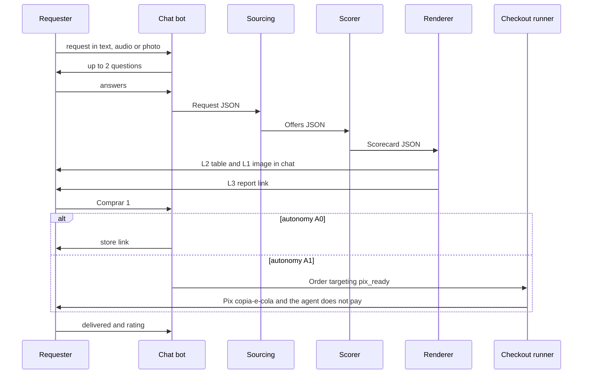

# Design — Family cohort #1

> Status: draft. Approval = André merges the PR. Until then, implement only T0 (contracts).

## 1. Flow



## 2. Where the requester reads what

| Step | Surface | Content | AC |
|---|---|---|---|
| 1 Request | chat | free text, audio or photo | AC-1 |
| 2 Clarify | chat | ≤ 2 questions with quick-reply buttons | AC-1 |
| 3 Summary (the "RFQ summary") | chat | **L2** top-3 table + **L1** 9:16 image of ≤ 6 options | AC-4 |
| 4 Deep read | PDF in chat + web link | **L3** scorecard, risks, excluded offers, savings | AC-5 |
| 5 Buy | store page (A0) or Pix in the user's bank app (A1) | link or Pix copia-e-cola | AC-6 |
| 6 Follow-up | chat | status, delivery, 1–5 rating | AC-7 |

Most decisions should happen at step 3. Step 4 exists for high tickets and for trust.
Visual reference: `./sketch/rfq-flow.html` (illustrative data, numbers match §4).

## 3. Components

| Component | Responsibility | Tech / reuse | Task |
|---|---|---|---|
| Contracts | Request, Offer, Scorecard, Order schemas → typed models | JSON Schema in `./contracts/` | T0 |
| Chat bot | one poller per token, idempotent replies, buttons | existing Telegram bot | T2 |
| Intake | normalize request, ask ≤ 2 questions | Claude or GPT only (family content) | T1 |
| Sourcing | ≥ 3 sources, landed cost to CEP, seller signals | public pages, aggregators, SearXNG + reader; no login | T3 |
| Assurance + scorer | exclusion rules + weighted score | deterministic code, no LLM in the math | T4 |
| Renderers | L1 PNG 1080×1920, L2 text, L3 PDF/web | reuse the Aircraft Fit 9:16 renderer if present (verify path) | T5 |
| Flow | wire steps, timers, buttons | — | T6 |
| Checkout runner | A1 only: cart → payment step → Pix code | Playwright on i7, logged sessions never leave i7 | T7 |
| Ledger + rating | Orders, rating prompt | local JSON | T8 |
| Money guard | A2 disabled, ceiling, logging | policy module + tests | T9 |
| Metrics | WEEK1 report | script over local data | T10 |

## 4. Scorecard math

Weight profiles (sum = 1.0):

| Profile | quality | value | assurance | popularity | delivery | warranty |
|---|---|---|---|---|---|---|
| `durables_v1` | 0.25 | 0.25 | 0.20 | 0.10 | 0.10 | 0.10 |
| `electronics_v1` | 0.25 | 0.30 | 0.20 | 0.10 | 0.10 | 0.05 |
| `pharmacy_v1` | 0.05 | 0.35 | 0.25 | 0.05 | 0.30 | 0.00 |

- **Reference** = median `landed_cost_brl` of offers that passed assurance.
- **value** = clamp(5 + 25 × (reference − landed) / reference, 0, 10). 20% below reference → 10; 20% above → 0.
- **delivery** = 10 if arriving ≥ 2 days before deadline, 8 at 1 day before, 6 on the deadline, 0 after (and flag `deadline_miss`).
- **quality, popularity, warranty, assurance** = 0–10 from extracted signals; the extraction may use an LLM, the arithmetic never does.
- **total** = Σ weight × score, rounded to 1 decimal. Rank by total; ties → lower landed cost.

Golden example (used by the T4 test and the sketch; deadline Sat, reference R$ 2.890 = median of 7 valid offers):

| Offer | Landed | quality | value | assurance | popularity | delivery | warranty | Total |
|---|---|---|---|---|---|---|---|---|
| A · 101 L | 2.749 | 8.5 | 6.22 | 9.5 | 8.8 | 10 | 9 | **8.4** |
| B · 100 L | 2.588 | 7.9 | 7.61 | 9.0 | 7.5 | 8 | 7 | **7.9** |
| D · 98 L | 2.890 | 8.2 | 5.00 | 9.0 | 7.0 | 10 | 8 | **7.6** |
| C · 96 L | 2.388 | 7.0 | 9.34 | 8.0 | 6.5 | 0 | 7 | **7.0** |
| X · 100 L | 1.899 | — | — | — | — | — | — | excluded |

## 5. Assurance rules (exclude from top-3; thresholds tuned by research H2)

| Check | Rule (v1) |
|---|---|
| `price_outlier_low` | landed < 0.75 × median of same-model offers |
| `new_seller` | seller account < 6 months |
| `low_reviews` | seller reviews < 100 |
| `no_cnpj` | business seller without a valid CNPJ shown |
| `unofficial_listing` | brand sells officially on the same marketplace and this seller is not it, with price below official |
| `spec_mismatch` | listing contradicts a must-have |

## 6. Autonomy ladder (the payment-delegation model)

| Level | Agent does | Human does | Gate to unlock next level |
|---|---|---|---|
| A0 | research + link | buys in the store | requester opts in to A1 and André approves |
| A1 | checkout up to payment, returns Pix code | pays in own bank app | ≥ 5 orders, 0 wrong items, mean rating ≥ 4, rail chosen (H5), dedicated account funded |
| A2 | pays from dedicated account ≤ `PIX_CEIL` | gets notified | 4 weeks of A2 without incident |
| A3 | recurring rules | sets rules | later |

Week 1 runs A0 for everyone and A1 for André only. Raising autonomy = raising the ceiling, never removing it.

## 7. Model routing

| Step | Model | Constraint |
|---|---|---|
| Intake, clarifying questions | gpt-6.1-sol low or Claude Sonnet low | family content → Claude/GPT only |
| Audio transcription | local first, else GPT | never a non-Claude/GPT third-party API |
| Page extraction (public web) | gpt-6.1-sol low; DeepSeek fallback | public content only |
| "Why" lines, L3 narrative | gpt-6.1-sol low | ≤ 120 chars per why |
| Scoring | code | no LLM |

## 8. Local data layout (never committed — this repo is public)

```
~/isaura-data/
  cohort/INPUTS.md            André's answers (CEP, handles, ceiling)
  cohort/requests/*.json      Request
  cohort/offers/*.json        Offer
  cohort/scorecards/*.json    Scorecard
  cohort/orders/*.json        Order (ledger)
  cohort/WEEK1.md             AC-9 report
  ops/guardrail.log  ops/kill.log  ops/dispatch.md  ops/quota.jsonl
```

## 9. Failure modes

| Failure | Behavior |
|---|---|
| Duplicate delivery | idempotency key = chat message id; second send is dropped and logged |
| Source 403 or captcha | skip source, count in footer; never bypass |
| Price moved > 3% at checkout | stop A1, show old vs new, ask |
| Marketplace session expired | fall back to A0 link; tell André once |
| Codex quota exhausted mid-task | CC finishes with Sonnet; note in dispatch log |
